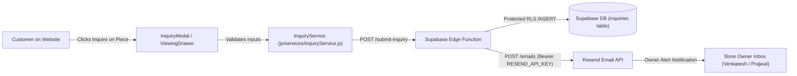

# SUPABASE & RESEND EMAIL INTEGRATION GUIDE
## Kashinathsa Y. Khatawate Jewellers (KYK Since 1937) · Gadag, Karnataka

This guide details the complete process to configure and deploy the **Supabase Inquiry System** and **Resend Owner Email Notification** backend.

---

### Architecture Overview



---

### Step 1: Create Supabase Project

1. Log in to your [Supabase Dashboard](https://app.supabase.com).
2. Click **"New Project"**.
3. Set:
   - **Name**: `KYK-Jewellers-Storefront`
   - **Database Password**: Generate and securely store a strong password.
   - **Region**: `ap-south-1` (Mumbai) or closest region for lowest latency in India.
4. Wait for database provisioning to finish.

---

### Step 2: Deploy the Database Schema & RLS Policies

1. In your Supabase Dashboard, navigate to the **SQL Editor** tab.
2. Open the migration file: [supabase/migrations/20261124_create_inquiries_table.sql](file:///d:/Jewellery/supabase/migrations/20261124_create_inquiries_table.sql).
3. Copy the entire contents into the SQL Editor and click **Run**.
4. The migration executes:
   - Creates the `inquiries` table with strict data types and constraints (`customer_name`, `email`, `phone`, `product_id`, `product_name`, `message`, `status`, `notification_status`).
   - Creates performance indexes on `created_at`, `product_id`, `status`, and `email`.
   - **Enables Row Level Security (RLS)**.
   - Grants public/anonymous users **INSERT only** rights (prevents unauthorized data harvesting).
   - Grants authenticated staff **SELECT/UPDATE** rights for management.

---

### Step 3: Deploy the Supabase Edge Function

1. Install the Supabase CLI on your workstation:
   ```bash
   npm install -g supabase
   ```
2. Log in and link your project:
   ```bash
   supabase login
   supabase link --project-ref your-project-id
   ```
3. Deploy the Edge Function:
   ```bash
   supabase functions deploy submit-inquiry --no-verify-jwt
   ```
4. Note the function URL: `https://your-project-id.supabase.co/functions/v1/submit-inquiry`.

---

### Step 4: Configure Supabase Secrets (for Server-side Email Alerts)

To deliver email notifications without exposing keys to the browser, configure secrets in Supabase:

1. Obtain a Resend API key at [resend.com](https://resend.com).
2. Run in terminal:
   ```bash
   supabase secrets set RESEND_API_KEY=re_your_api_key_here
   supabase secrets set OWNER_NOTIFICATION_EMAIL=kykjewellers1937@gmail.com
   supabase secrets set NOTIFICATION_FROM_EMAIL=inquiries@kykjewellers.com
   ```
3. Alternatively, in the Supabase Dashboard, go to **Edge Functions** &rarr; **Secrets** and add the keys.

> [!NOTE]
> If `RESEND_API_KEY` is not provided, the Edge Function **still succeeds** in saving inquiries to the database, setting `notification_status = 'unconfigured'`. Customer inquiries are never lost.

---

### Step 5: Configure the Frontend

Update [js/config/supabase.js](file:///d:/Jewellery/js/config/supabase.js) with your project credentials:

```javascript
export const SUPABASE_CONFIG = {
  url: "https://your-project-id.supabase.co",
  anonKey: "eyJhbGciOi...your-public-anon-key",
  edgeFunctionUrl: "https://your-project-id.supabase.co/functions/v1/submit-inquiry"
};
```

Or inject via `window.SUPABASE_CONFIG` in your hosting provider's HTML template:
```html
<script>
  window.SUPABASE_CONFIG = {
    url: "https://your-project-id.supabase.co",
    anonKey: "eyJhbGciOi...",
    edgeFunctionUrl: "https://your-project-id.supabase.co/functions/v1/submit-inquiry"
  };
</script>
```

---

### Step 6: Testing the Inquiry Flow

1. **Test in Browser**:
   - Open any product modal in the website.
   - Click **"Book Salon Appointment"** or **"Send Product Inquiry"**.
   - The modal automatically loads the product thumbnail, name, SKU (`PROD-001`, `PROD-003`, etc.), and gold hallmark.
   - Enter full name, email, optional phone number, and message.
   - Click **"Transmit Private Inquiry"**.
2. **Examine Database**:
   - In Supabase Dashboard &rarr; **Table Editor** &rarr; **inquiries**, verify the new row appears with `status = 'new'`.
3. **Verify Security**:
   - Open a browser incognito tab and run in the console:
     ```javascript
     fetch("https://your-project-id.supabase.co/rest/v1/inquiries", {
       headers: { apikey: "YOUR_ANON_KEY" }
     }).then(r => r.json()).then(console.log);
     ```
   - **Result**: `[]` (Empty array). RLS blocks public read access! Customer privacy is 100% safeguarded.
